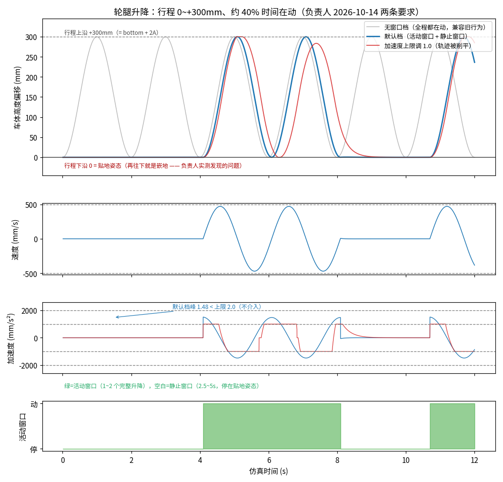
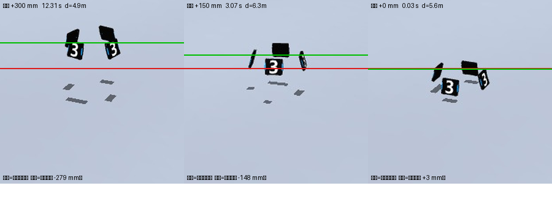

# rm_sim/configs —— 仿真参数配置层

**为什么单独一层**：24→25→26 赛季规则一直在变（血量、热量上限/冷却、伤害、弹丸、靶型…），
把这些数值从代码里搬出来放进 YAML，换赛季就是"换一个文件"，逻辑一行不动。

## 文件职责

| 文件 | 放什么 | 谁读它 |
|---|---|---|
| `rules/legacy_sim.yaml` | **兼容档**：等价于"我们一直用到现在的简化模型"（热量 100/10、锁枪只拒单发、无等级/42mm/回血）。**默认规则集** | `rm_config.py` → `GunParams` / `rm_cars` |
| `rules/rmuc_2026.yaml` | 2026 赛季真实规则（逐条标注手册出处页码）：热量双阈值/锁到归零、初速超限、伤害表、等级性能表、回血复活、弹药经济、基地前哨站 | 同上（切 `--ruleset rmuc_2026`） |
| `projectiles.yaml` | 弹丸：几何/质量/公差/材质/数量/初速上限/检测阈值（17mm 与 42mm） | `rm_config.py` → 弹道与命中判定 |
| `projectile_spread.yaml` | 散布：枪口角散布 + **由直径/质量公差引起的弹速与阻力散布**（后者默认关，待校准） | `rm_gun.py` |
| `armor.yaml` | 装甲模块尺寸：小 140×125（**仿真已在用**）、大 235×127（仅记录，未建模）、灯条几何（PnP 用）、暴击区 | `rm_config.py`、文档 |
| `targets.yaml` | 靶车：兵种/血量/装甲 + **运动行为**（含轮腿升降），以及基准测试的"靶型预设" | `rm_car_script.py` / `rm_lift.py` |

## 三条硬规则

1. **默认行为必须与"没有配置层之前"完全一致** —— 默认规则集是 `legacy_sim`，
   并且有黄金轨迹回归（`auto_aim_rl/scratch/golden_trace.py` 的 qpos hash 必须不变）。
   否则既有基线（4 种子 46.5% vs 39.0%）就没法复现了。
   * 现值：`c76a72ab6149211b800259e871dad902`。
   * **2026-10-14 变更过一次**（原 `6c974ec8…`）：修掉了基准脚本里「小陀螺状态机泄漏」——
     第 2 段的 `inplace_spin` 之后，后面每一段都还在按小陀螺转（`car_motion_mode` 一直是 gyro，
     分靶型统计被污染）。这是**故意的行为修复**，代价是此前所有 script 模式的存档数字
     都不再可比（含 RL vs sp_vision 的验收存档 —— 两侧同条件，结论方向仍成立，但要重录）。
2. **每个数值都要有出处**：规则值写 `source: "手册 §x.y 表 5-xx (PDF pNN)"`；
   没有数据源的（机械规格等）写 `【待校准】`；负责人拍板的写 `【负责人指定 YYYY-MM-DD】`。
3. **单条规则可降级**：`mode: exact | simplified | off`，便于"逐条对齐现实"和 A/B。

## 轮腿靶车的车体升降（负责人 2026-10-14）

轮腿步兵交战时会**升/降车体**（四块装甲板整体上下移动），通常还叠着变速小陀螺。
对自瞄来说这是**竖直方向第一个真实的预测误差来源** —— 以前靶车的 z 几乎是静止的
（只有地形起伏 + 安装角偏移），正好打在自瞄最弱的一环上。

| 量 | 取值 | 出处 |
|---|---|---|
| 升降半幅 | 150 mm | 【负责人指定 2026-10-14】 |
| 行程 | **0 ~ +300 mm**（下沿 = 贴地姿态） | 【负责人指定 2026-10-14】+ 几何硬约束，见下 |
| 一个完整升降 | ≈ 2 s | 【负责人指定 2026-10-14】 |
| 加速度 / 速度上限 | 2.0 m/s² / 0.5 m/s | 【待校准】—— 反推出的『刚好不扭曲指令』的值 |
| 占空比 | 活动 1~2 个周期（2~4 s）+ 静止 2.5~5 s | 【负责人指定 2026-10-14】「不期望全部时间都在动」 |

### 为什么行程是 0 ~ +300 而不是 ±150（负责人实测发现「装甲板嵌地上」）

量了几何才知道：我们的靶车是**单个自由体**，「贴地姿态」（= 其它所有靶型用的那个姿态）
就是**车体几何最低点正好落在地面上**（`ride_z ≈ −4 mm`，网格最低点 = 轮子底面），
而且装甲板下沿只有 **+65 mm**。所以任何**下行程都等于往地下钻**：−150 mm 会让装甲板埋进地里 85 mm。

现在改成「下沿 = 贴地姿态、上沿 = +300」的**非对称正弦**
（`target = bottom + A·(1+sinφ)`，半幅仍是 150 —— 只是把中位抬到 +150）：
既不嵌地，又保住了 300 mm 的行程和干净的解析波形。
`bottom_mm` 写死 ≥ 0（给了负值会被自动夹回 0，自检里有一条专门的回归）。

真机上「降低车体」是腿收拢、**轮子仍在地面**；单刚体模型做不到，所以宁可少一段下行程。
想让车体也能往下走，只能先给它一个抬高的基准姿态 —— **未实现**。

### 占空比：不是全程都在动

活动窗口 = 1~2 个完整升降（2~4 s），结束后回到贴地姿态**静止 2.5~5 s**，两者都随机抽，
宏观上约 **40% 的时间在动**，其余时间是「普通静止靶」。两个的起止都落在
「贴地姿态 + 速度为 0」上（正弦相位从 −π/2 起、按整数周期结束），所以进出窗口是平滑的。



**这两个上限怎么定的**：150 mm / 2 s 的正弦本身需要峰值速度 A·ω ≈ 0.47 m/s、
峰值加速度 A·ω² ≈ 1.48 m/s²。默认取 0.5 / 2.0 就是「**限幅平时不介入、调紧才生效**」：
实测默认档 0% 的步落在饱和上、峰加速度 1.48 < 2.0；把加速度上限调成 1.0 就变成贴上限跑、
轨迹被削平（上图红线）。注意收紧上限**不会**把行程压小 —— 下沿被地面钉住、上沿被行程钉住，
变的只是轨迹形状。

**模型边界（写清楚免得误读）**：

* 限幅值**必须 ≥ 上面两个物理需求**，否则机构跟不上指令 —— 那时轨迹不再等于解析式
  （贴着上限、被削平）。这是模型的有效域边界，不是仿真错了。
* 我们的靶车是**单个自由体**，所以「升降」是整车平移（轮子也一起抬起来）；
  真机是轮子留在地面、只有车体升降。对自瞄的竖直误差两者等价，只是外观不同。
* 大装甲板（235×127）**没有建模**，只在 armor.yaml 里记录尺寸。

### 四种带升降的靶型（负责人 2026-10-14 点名）

经典四型各自叠加车体升降，进基准脚本；运动学由 `rm_car_script.py` 的 `_SPEC` 定义：

| 靶型 | 平移 | 自转 | 升降 |
|---|---|---|---|
| `lift_static` 固定升降靶 | 停住 | **不转** | periodic |
| `lift_linear` 左右移动升降靶 | 巡逻 | **不转** | periodic |
| `lift_spin` 原地旋转升降靶 | 停住 | 匀速旋转 | periodic |
| `lift_random` 随机旋转移动升降靶 | 巡逻 | 变速（小陀螺） | periodic |

预设 `benchmark_2026_lift` = 这四段（10 s 一段、乱序）。实测四型都正确：
固定/直线靶 ω = 0、固定靶平移漂移 0.00 m、旋转靶 ω 5~7 rad/s，升降都是 0~300 mm、占空比 0.40~0.47。

**优先级**：`--car-lift`（命令行显式给） **>** 靶型自带的 lift **>** 默认 off。
跑 `--car-motion script` 时老 4 段靶型的 lift 都是 off，反过来的话 `--car-lift periodic` 会被静默吃掉
（表现为「参数加了没效果」）。

**怎么用**：

```bash
# 1) 联调：给所有靶车加定频升降
SIM_ARGS="--car-lift periodic" bash tools/run_debug.sh
# 2) 基准：四种带升降靶型（与 4 段 legacy 基线不混用）
CAR_SCRIPT_PRESET=benchmark_2026_lift bash sp_vision_25/sim/eval_policy.sh lift4 150 20251012 777
# 3) 自检
~/mjlab-env/venv/bin/python rm_sim/test_wheel_legged.py
```

**联调时怎么确认它真的在动**：浏览器状态条（`http://127.0.0.1:8099`）会多出一段
`| 车1 升降 +132mm (periodic·动)`，随车体高度实时跳，`·动/·停` 直接告诉你现在是不是在升降窗口里；
**没开升降就不显示这一段**（不污染正常跑的读数）。口径 = `/state.json` 的 `car_lift`。

**核对记录**（从渲染画面反推，不是只看模型内部状态）：抓 303 帧 overview 真彩图 + 同步真值，
量「装甲板上沿相对『无升降基准』的高度」，对指令升降做回归 —— 斜率 **−0.935**
（理想 −1.00；若渲染完全没跟随升降则为 0.00），残差 RMS 8 mm ≈ 1 像素。



两张图都是**可复现**的：`tools/capture_lift_frames.py`（起仿真 + 同步抓帧 + 真值，约 30 s）
→ `tools/make_lift_figs.py`（量测 + 出图，秒级）。

## 换赛季怎么做

```bash
cp configs/rules/rmuc_2026.yaml configs/rules/rmuc_2027.yaml   # 只改数值
# 然后 --ruleset rmuc_2027 即可；代码、测试、脚本都不动
```
